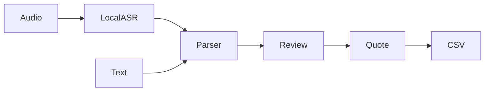

# VoiceQuote Desk

**Turn a spoken materials request into a reviewable quote.**

[](https://github.com/ashutosh0sharma1/voicequote-desk/actions/workflows/ci.yml)

## What you can do

Offline ASR option, strict extraction, fixture prices, human review, Decimal totals, idempotent saves and formula-safe CSV.

## How it works



## Quick start

```sh
python -m venv .venv
# Activate .venv, then:
python -m pip install -r requirements.txt
python -m uvicorn app:app --host 127.0.0.1 --port 8806
```

## Verify

```sh
python -m pytest test_quotes.py -q
```

[VALIDATION.md](VALIDATION.md) records checks actually run against this export and their limits.

## Boundaries

Synthetic local demo without production authentication or supplier integration. ASR requires a separately cached faster-whisper small model and refuses request-time downloads. Typed input needs no model. generate_samples.ps1 creates synthetic WAVs on Windows.

## Contribute

Start with a small synthetic reproduction. Improvements to portable setup, failure recovery, documentation and regression coverage are welcome. Read [CONTRIBUTING.md](CONTRIBUTING.md) before opening a pull request.

## License and provenance

See [LICENSE](LICENSE) and [THIRD_PARTY_NOTICES.md](THIRD_PARTY_NOTICES.md). This clean source export excludes private data, credentials and development history.
